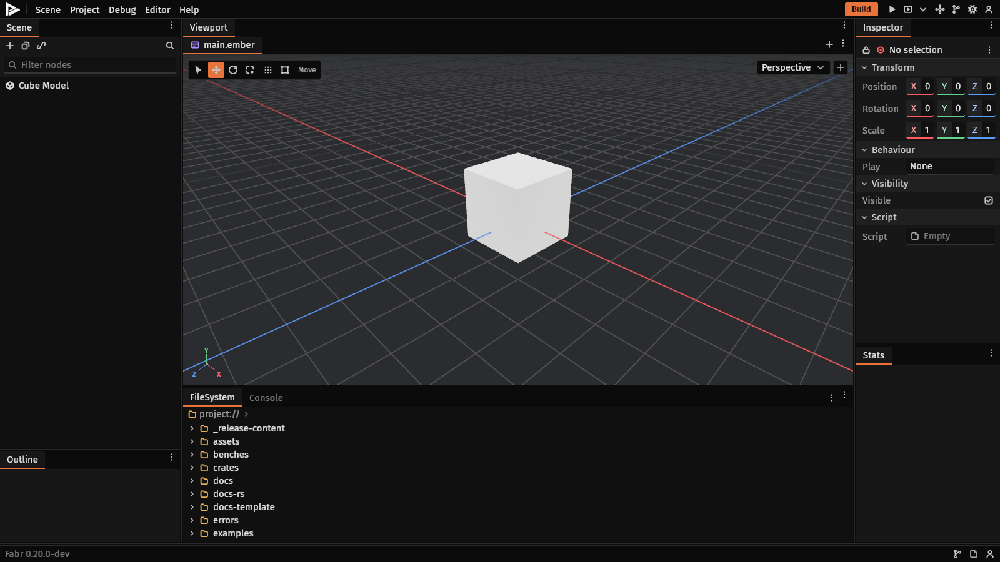

<p align="center">
  
</p>

<h3 align="center">A game engine with an editor, built on Bevy.</h3>

<p align="center">
  <a href="#license"></a>
  <a href="https://discord.gg/EWb5w2TcnF"></a>
  
</p>



## What is Fabr?

Fabr is a game engine you can open, drag things around in, script, and export to a binary.

It is a fork of [Bevy](https://bevy.org). Bevy gives you a very good ECS, renderer and asset
pipeline with no editor attached — you write Rust, run `cargo`, and build your own tooling around
it. Fabr keeps that engine and adds the layer on top: a dockable editor, gameplay scripts in
three languages, and a build step that produces something you can hand to a friend.

It is pre-1.0, it is Linux-first, and it is one person's work in progress. What follows is what
exists, including the parts that don't work yet.

## Editor

Panels for hierarchy, inspector, viewport, file browser, console and stats. Split them, drag
them into new tabs, and the layout is saved per project.

- Move, rotate and scale gizmos
- Undo and redo through the scene
- Scenes are plain-text `.ember` files, so they diff and merge like any other source file
- glTF import with per-instance material overrides
- Stats panel with live frame time

## Scripting

Pick a language per object. All three sit behind the same interface.

- **Lua** — a nine-line file gets an object spinning. No build step, no boilerplate.
- **C#** — real .NET through a `FabrScript` base class, loaded in a collectible context so
  reloads don't leak
- **Rust** — the `fabr` crate, compiled into the game

Lua and C# reload the moment you save. No restart, no lost play state. Rust is compiled into the
host and needs a rebuild — it is not hot-reloaded, and the docs won't pretend otherwise.

## Export

Build panel, pick a target, get a binary.

- Linux and Windows targets
- The release player is about 5 MB before your assets
- The player reads the same `.ember` scenes the editor writes, so there is no editor-only format

## Engine

The engine underneath is Bevy: ECS, renderer, asset pipeline, UI, audio and reflection.

- Physics with broadphase collision
- Navigation meshes
- Animation graphs and transitions
- Client/server networking over TCP
- 2D sprites and 3D PBR rendering

## Extensibility

- A `fabr` plugin API for adding systems to a running game
- An editor extension API for adding panels and tools without forking the editor
- Packages install from folders

## Getting started

```sh
git clone https://github.com/Wakcli/Fabr
cd Fabr
cargo run -p eme_editor
```

Needs a recent stable Rust toolchain and a Vulkan or DX12 capable GPU. Linux is the supported
host; the editor builds on Windows, but nobody has used it there for long enough to promise it
works.

To run the player on its own:

```sh
cargo run -p eme_player -- scenes/main.ember
```

## Status

- No macOS and no mobile targets
- The Windows export builds, but has never been run on Windows hardware
- The C# loader needs the matching .NET reference assemblies on the host
- Asset registries resolve from folders only; there is no HTTP registry client
- The demo scene references a managed assembly that isn't checked in, so it logs a load error
  until you build one

If something on this list should not be on it, that is worth an issue.

## Contributing

The most useful things right now, roughly in order:

- **Run it and report what breaks.** Windows and the export path are the thinnest parts. A
  paragraph and a screenshot is enough.
- **Make a game with it and complain.** Jam-sized is fine. The friction you hit is the roadmap.
- **Rendering, editor and viewport work.** Known rough edges are filed; ask for one.
- **Docs and examples.** Plenty of the tree still describes a different project.

Open an issue before a large change so nobody builds the same thing twice. Small fixes can go
straight to a pull request. See [CONTRIBUTING.md](CONTRIBUTING.md).

There is a Discord: **https://discord.gg/EWb5w2TcnF**. Work in progress gets shown there first.

## License

MIT OR Apache-2.0, the same terms as the Bevy it is built on. Fabr is a modified fork; upstream,
its contributors and its assets are credited in [CREDITS.md](CREDITS.md) and
[THIRD-PARTY-LICENSES.md](THIRD-PARTY-LICENSES.md).
